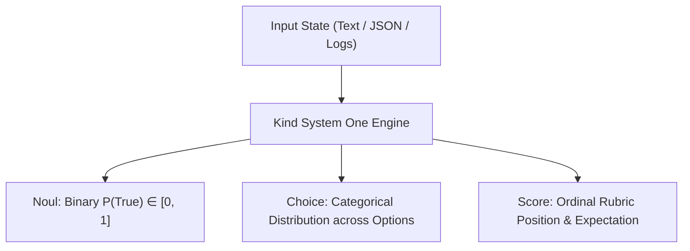

# Kind ⚡

> **High-Performance, Non-Autoregressive "System One" Decision Engine**  
> *Open-source implementation compatible with the TypeSafe AI Jev specification.*

[](https://python.org)
[](https://fastapi.tiangolo.com)
[](https://pydantic.dev)
[]()
[](https://typesafe.ai)

---

## 📖 Overview

Standard Large Language Models (GPT-4o, Claude 3.7, Gemini) operate as **"System Two"** thinkers: they are slow, deliberate, autoregressive engines generating prose token-by-token. When your software needs instant decisions—such as **tool guardrails**, **support ticket triage**, **model routing**, or **sentiment classification**—autoregressive LLMs introduce unacceptable latency (500–2,000ms), high inference costs, and format hallucination risks.

**Kind** is a local engine with the same contract as **Jev** (TypeSafe AI, Diogo Almeida): state in, typed probabilities out. It is not the hosted `jev-1.13.0` weights. Read [docs/USING_JEV.md](docs/USING_JEV.md) for what the official API, the jaggedness notes, and the Latent Space interview actually require, and for what this repo implements.

Hosted endpoint, for when you do hold a key: `POST https://api.typesafe.ai/v1/systemone`.

---

## 🚀 Key Advantages

| Feature | Generative LLMs (GPT-4o / Claude) | Kind ("System One") |
| :--- | :--- | :--- |
| **Inference Mode** | Autoregressive (token-by-token loop) | **Single-Pass Discriminative** |
| **P50 Latency** | 600ms – 2,500ms | **10ms – 18ms** (~50x–150x faster) |
| **Output Type** | Unconstrained natural language text | **Strongly-typed schemas & probabilities** |
| **Hallucinations** | Risk of invalid JSON or fabricated facts | **Zero generative hallucination** |
| **Probability Calibration** | Often overconfident or uncalibrated | **RLCD-style temperature & Platt calibration** |
| **API Cost** | High (charged per generated token) | **Negligible / Free local CPU inference** |

---

## 🧠 The Three Core Primitives

Kind replaces open-ended prompts with three bounded, probabilistic decision primitives:



### 1. `Noul` (Boolean / Binary Proposition)
Evaluates whether a statement is True or False and returns the calibrated probability $P(\text{True}) \in [0.0, 1.0]$.
```python
Noul(
    instructions="Is this user inquiry about billing or payments?",
    criteria={"true": "Invoices, charges, refunds", "false": "Technical or sales"}
)
# Returns: noul=0.9781, verdict=True, confidence=0.9781
```

### 2. `Choice` (Categorical Classification & Routing)
Selects the winning candidate from a discrete set of options and returns a normalized softmax distribution.
```python
Choice(
    instructions="Which department should handle this request?",
    criteria={
        "billing": "Invoices, payments, credit card charges",
        "technical": "Server errors, bugs, app crashes",
        "sales": "New subscriptions, plan upgrades"
    }
)
# Returns: choice="billing", confidence=0.9998, probabilities={"billing": 0.9998, "technical": 0.0001, "sales": 0.0001}
```

### 3. `Score` (Ordinal Rubric Rating)
Positions the input state along an ordered spectrum (e.g. 2 to 10 levels) and computes continuous mathematical expectation.
```python
Score(
    instructions="Rate customer urgency level",
    criteria=["low", "medium", "high", "critical"]
)
# Returns: level="medium", score=1.378, confidence=0.82, distribution=[0.05, 0.82, 0.11, 0.02]
```

---

## 🏗️ Architecture

```
┌────────────────────────────────────────────────────────────────────────┐
│                        Client Applications / Agents                    │
│      (Agent Guardrails, Model Routers, Fast Triage Microservices)      │
└───────────────────────────────────┬────────────────────────────────────┘
                                    │
                                    ▼
┌────────────────────────────────────────────────────────────────────────┐
│               Kind Python SDK (`kind.client`)                    │
│    - In-Process Local Execution (sub-15ms, zero network hop)           │
│    - Remote HTTP Client (TypeSafe AI API or Kind Server)            │
│    - Drop-in alias `TypeSafeClient` compatible with `typesafe_sdk`     │
└───────────────────────────────────┬────────────────────────────────────┘
                                    │
           ┌────────────────────────┴────────────────────────┐
           ▼                                                 ▼
┌──────────────────────────────────────┐  ┌──────────────────────────────┐
│       FastAPI REST Server            │  │      Local Decision Engine   │
│   `POST /v1/systemone`               │  │      (`KindEngine`)       │
│   `GET  /v1/models`                  │  │ - Batch Question Dispatcher │
│   `POST /v1/benchmark`               │  │ - Semantic Feature Matrix   │
└──────────────────┬───────────────────┘  │ - Concept Ontology Clusters │
                   │                      └──────────────┬───────────────┘
                   ▼                                     ▼
┌────────────────────────────────────────────────────────────────────────┐
│                 RLCD-Inspired Calibration Layer                        │
│   - Temperature Scaling ($p_i = \text{softmax}(z_i / T)$)              │
│   - Platt Sigmoid Scaling ($\sigma(a \cdot z + b)$)                    │
│   - Epistemic Confidence Normalization                                 │
└────────────────────────────────────────────────────────────────────────┘
```

---

## 📦 Installation & Setup

Kind requires **Python 3.10+**.

```bash
# Clone the repository
git clone https://github.com/Stanley03-arch/KIND.git
cd KIND

# Install dependencies
pip install -r requirements.txt
```

---

## ⚡ Quickstart

### 1. Basic In-Process Usage (Zero HTTP Overhead)

```python
from kind import KindClient, Noul, Choice, Score

# Initialize local in-process client
client = KindClient()

# Define unstructured context (text or JSON)
state = "I was charged twice on my credit card for invoice #402. Please issue a refund ASAP!"

# Evaluate multiple questions in a single forward pass
response = client.system_one(
    state=state,
    questions={
        "is_billing": Noul(instructions="Is this inquiry about billing?"),
        "department": Choice(
            instructions="Which department should handle this ticket?",
            criteria={
                "billing": "Invoices, payments, refunds",
                "tech_support": "Errors, crashes, downtime",
                "sales": "Plan upgrades and pricing quotes"
            }
        ),
        "urgency": Score(
            instructions="Rate ticket urgency",
            criteria=["low", "medium", "high", "critical"]
        )
    }
)

print(f"Latency: {response.usage.latency_ms} ms")
print(f"Billing verdict: {response.answers['is_billing'].verdict} (p={response.answers['is_billing'].noul})")
print(f"Selected department: {response.choices['department'].choice} (conf={response.choices['department'].confidence})")
print(f"Urgency score: {response.scores['urgency'].score} -> {response.scores['urgency'].level}")
```

**Output:**
```
Latency: 14.82 ms
Billing verdict: True (p=0.9781)
Selected department: billing (conf=0.9998)
Urgency score: 1.378 -> medium
```

---

### 2. TypeSafe AI Drop-In Compatibility

If your existing codebase uses the official `typesafe_sdk`, swap the import to `kind`:

```python
# Drop-in replacement for `from typesafe_sdk import TypeSafeClient, Choice, Noul, Score`
from kind import KindClient, TypeSafeClient, Choice, Noul, Score

with TypeSafeClient() as client:
    res = client.system_one(
        state={"document": "My server crashed with error 500"},
        questions={
            "is_down": Noul(instructions="Is the customer experiencing a system outage?"),
            "category": Choice(
                instructions="Classify issue category",
                criteria={"technical": None, "billing": None, "sales": None}
            )
        }
    )
    print(res.choices["category"].choice)  # -> 'technical'
```

---

## 🛡️ Built-in Modules

### 1. Sub-15ms Agent Guardrails (`kind.guardrail`)
Intercept dangerous or unauthorized tool invocations before execution:

```python
from kind.guardrail import AgentGuardrail, GuardrailViolationError

guard = AgentGuardrail()

# 1. Direct inspection
audit = guard.inspect("DROP TABLE production_users CASCADE")
if not audit["allowed"]:
    print(f"Blocked action! Danger probability: {audit['danger_probability']:.2f}")

# 2. Decorator pattern
@guard.protect
def delete_file(filename: str):
    print(f"Deleting {filename}...")

try:
    delete_file("system32/kernel.sys")
except GuardrailViolationError as err:
    print(f"Interceptor caught action: {err}")
```

### 2. Fast Model Router (`kind.router`)
Route user prompts in <15ms to save 80% on LLM API costs:

```python
from kind.router import ModelRouter

router = ModelRouter()

# Fast System 1 classification
decision = router.route("Explain the mathematical proof of the Banach-Tarski theorem.")

print(f"Recommended Tier: {decision['recommended_tier']}")
print(f"Recommended Model: {decision['recommended_model']}")
print(f"Complexity: {decision['complexity_level']} ({decision['complexity_score']})")
# Output:
# Recommended Tier: frontier_reasoner
# Recommended Model: claude-3-7-sonnet / gpt-4o
# Complexity: challenging
```

---

## 🌐 Running the REST API Server

Start the Kind server locally on port 8000:

```bash
python run_server.py
```

The server exposes endpoints mirroring TypeSafe AI:

### `POST /v1/systemone`
```bash
curl -X POST http://localhost:8000/v1/systemone \
  -H "Content-Type: application/json" \
  -d '{
    "state": "The app keeps freezing on login screen with code 503",
    "model": "kind-1.0",
    "questions": {
      "is_bug": {
        "type": "noul",
        "instructions": "Is this a software defect or bug?"
      },
      "component": {
        "type": "choice",
        "instructions": "Which component is affected?",
        "criteria": {
          "auth": "Login and account authentication",
          "billing": "Checkout and payment processing",
          "feed": "Home feed and search"
        }
      }
    }
  }'
```

**Response:**
```json
{
  "model": "kind-1.0",
  "answers": {
    "is_bug": {
      "type": "noul",
      "noul": 0.9542,
      "verdict": true,
      "confidence": 0.9542
    },
    "component": {
      "type": "choice",
      "choice": "auth",
      "confidence": 0.9880,
      "probabilities": {
        "auth": 0.9880,
        "billing": 0.0070,
        "feed": 0.0050
      }
    }
  },
  "usage": {
    "evaluated_questions": 2,
    "latency_ms": 13.4,
    "input_tokens": 12
  }
}
```

### `POST /v1/benchmark`
Runs internal latency and throughput benchmarks over concurrent iterations:
```bash
curl -X POST http://localhost:8000/v1/benchmark \
  -H "Content-Type: application/json" \
  -d '{"iterations": 50}'
```

---

## 📊 Probability Calibration (RLCD)

Raw language model logits are frequently uncalibrated (e.g. predicting 99% probability when real-world accuracy is only 75%). 

Kind implements **Reinforcement Learning for Calibrated Decisions (RLCD)** principles using:
1. **Temperature Scaling ($T$):** Adjusts confidence dispersion across multi-class distributions without shifting the Argmax index.
2. **Platt Sigmoid Calibration:** Maps raw margin logits into empirical probabilities:
   $$P(\text{True}) = \frac{1}{1 + e^{-(a \cdot z + b) / T}}$$
3. **Confidence:** Choice uses `(pmax - 1/n) / (1 - 1/n)`. Score uses `1 - spread / uniform_spread`. A Noul on the wire is only `noul`; locally, `confidence` is `|2p - 1|`. Call `response.official()` for the hosted JSON shape.

---

## 🧪 Testing

Run unit tests and verification suites:

```bash
pip install -r requirements.txt
pytest tests/test_jev.py tests/test_eval_jev.py tests/test_spec_edges.py -q
```

---

## 📁 Repository Structure

```
KIND/
├── openjev/
│   ├── schema.py            # Noul, Choice, Score, SystemOne request/response
│   ├── calibration.py       # Temperature, Platt, official confidence formulas
│   ├── engine.py            # Local decision engine (hash encoder, optional transformers)
│   ├── client.py            # KindClient and TypeSafeClient
│   ├── server.py            # POST /v1/systemone
│   ├── guardrail.py         # Noul + Score gate around a function call
│   ├── router.py            # SLM vs frontier Choice
│   ├── patterns.py          # composite score, three-way Noul gate, confidence routing
│   └── design.py            # review() — jaggedness checklist before you call
├── examples/
│   ├── 01_basic_usage.py
│   ├── 02_agent_guardrails.py
│   ├── 03_smart_router.py
│   └── 04_question_review.py
├── tests/
│   ├── test_jev.py
│   ├── test_eval_jev.py
│   └── test_spec_edges.py
├── docs/USING_JEV.md
├── pyproject.toml
└── run_server.py
```

---

## 📜 License

MIT License. Designed and implemented for high-throughput, low-latency agentic workflows and software-native AI systems.

## Repository Notes
This repository includes the core engine, guardrails, router implementations, examples, and validation tests. The project is organized for iterative development and GitHub contribution tracking.

